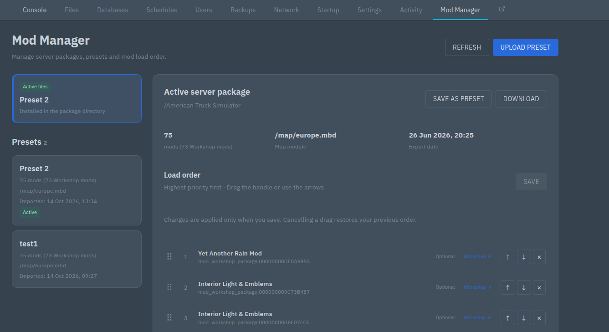
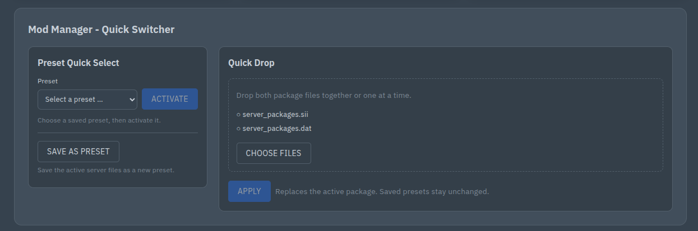

# ETS2-ATS-Mod-Manager

Manage Euro Truck Simulator 2 and American Truck Simulator dedicated-server packages from Pterodactyl v2. Keep named presets, switch the active package, view package metadata and Workshop links, and edit mod load order.

**Current version: 0.5.1. This project is in early development; 0.5.0 was its first release. Development was AI-assisted, including implementation, documentation and automated tests.** Automated checks cover the extension and Panel integration with simulated Wings file operations; game compatibility has not yet been verified on a real ETS2/ATS server. Removing mods is experimental because the binary map data is preserved rather than regenerated.

## Preview

### Mod Manager

Presets, active package metadata and editable mod load order.



### Console Quick Switcher

Preset Quick Select, Save as preset and two-file Quick Drop.



## 1. Install the extension

### Requirements

- Pterodactyl **v2** with native extension support, PHP 8.3 or newer, and MySQL or MariaDB. Pterodactyl 1.x and Blueprint are not supported.
- ETS2 or ATS dedicated-server eggs and access to their server files through Wings.
- Administrator access to the Panel.

The extension is tested against Panel commit `8e07ac97ab42d6b65b144ebf81d5f47da4f4fad1` on `2.0-develop` and SDK `2.0.0-beta.4`. See [compatibility.json](compatibility.json) for the tested environment. Custom Buttons does not need to be installed.

### Download and install

1. Open [Releases](https://github.com/LooxLuchs/ETS2-ATS-Mod-Manager/releases) and download the `.pteroext` file from the latest release.
2. Open the administration area of your Panel and navigate to **Extensions**.
3. Click **Install** in the top-right corner and select the `.pteroext` file. If you are upgrading an existing installation, confirm the replacement by selecting **Yes**. Once installation is complete, enable the extension.
4. Continue with **Configure each egg's package directory** below.

### Configure each egg's package directory

In **Admin → ETS2-ATS-Mod-Manager**, create an activation for each supported egg. Select the egg and game, enter the package directory, and enable the activation.

Use the directory from which that dedicated server actually loads `server_packages.sii` and `server_packages.dat`. Common paths are:

| Game | Package directory |
| --- | --- |
| Euro Truck Simulator 2 | `/.local/share/Euro Truck Simulator 2` |
| American Truck Simulator | `/.local/share/American Truck Simulator` |

Paths are relative to the server filesystem: `/` is normally `/home/container` inside the game container. `/home/container/…` is normalized to that root. The extension does not change startup arguments or egg configuration. Make sure the configured path agrees with your server setup.

The path editor supports the same server-value placeholders as Custom Buttons, such as `{{env.P_SERVER_NAME}}` and `{{env.P_SERVER_UUID}}`. See the [full placeholder list](docs/OPERATIONS.md#path-placeholders).

## 2. Use the Mod Manager

Enabled eggs show a **Mod Manager** tab. Opening it selects the files currently installed in the package directory. “Active” refers to installed files; restart the game server after replacing or editing them so it loads the new package. The extension does not restart servers automatically.

### Upload and activate presets

1. Export a matching `server_packages.sii` / `server_packages.dat` pair from the game using `export_server_packages`.
2. Open **Mod Manager → Upload preset**, enter a name, select both files and save. You can select them together or one at a time, or upload a ZIP containing exactly one pair in the same directory.
3. Select the saved preset to view its mods, Workshop links, map module and import/export dates. Mod counts include the number of Workshop mods.
4. Click **Activate** to install both files in the configured package directory, then restart the game server.

**Save as preset** saves the installed package under a new name. Presets can also be renamed, downloaded as ZIPs or deleted. Deleting a preset retains the active game files.

### Edit load order

Select the active package or a preset, then drag a mod by its handle, or use the arrow buttons. Highest priority is shown first; this corresponds to the last `mod_list` entry in the SII. **Save** becomes available when changes exist. **Reset** discards the draft.

Saving a preset updates that preset and creates a backup; activate it separately to update the server. Saving changes to the active package updates only the installed files. **Remove mod** requires confirmation of an experimental change: it removes the SII references but cannot regenerate the DAT map data. **Restore backup** restores an earlier saved version of a preset.

### Console quick controls

**Mod Manager - Quick Switcher** is below the Console and statistics:

- **Preset Quick Select:** Select a preset and press **Activate**. Choosing an entry alone does not change server files.
- **Save as preset:** Enter a name to save the currently installed package as a new preset.
- **Quick Drop:** Drop or select both package files, together or separately. Only **Apply** uploads the complete pair and replaces the active package. Saved presets are preserved. The staged files are local to the browser and are discarded when leaving the Console or reloading.

### Permissions, limits and recovery

| Action | Required subuser permissions |
| --- | --- |
| View or download packages | `file.read`, `file.read-content` |
| Upload, save, rename, edit, activate or restore | Also `file.create`, `file.update` |
| Import a ZIP | Also `file.archive` |
| Delete a preset or remove a mod | Also `file.delete` |

Only root administrators configure egg activations. Server owners and root administrators follow normal Panel access rules. Backend endpoints independently enforce permissions and server membership.

The default limits are **4 MiB SII** and **64 MiB DAT**, configurable under **Admin → Extensions → ETS2-ATS-Mod-Manager → Settings**. PHP and web-server upload limits must also allow the pair; recommended starting values are `upload_max_filesize=68M`, `post_max_size=72M` and `memory_limit=512M`.

Presets, backups and working files are stored under `/.ets2-ats-mod-manager/` within each server. Only the final `server_packages.sii` and `server_packages.dat` are installed in the game directory. Backups are retained and count against disk usage. Back up the server files and extension database tables.

Failed operations restore the previous pair when possible. An interrupted operation appears with **Recover** in the manager; resolve it before making more changes. Hash checks prevent overwriting files changed externally through SFTP or the file manager. See [storage and recovery details](docs/OPERATIONS.md#permissions-and-storage).

## Development, tests and packaging

The project lives directly in the repository root, with source code in [src/](src/). Run these commands from the repository root:

```sh
npm run prepare:sdk
npm ci
npm run typecheck
npm test
npm run test:php
npm run build
```

Use Node 22.12 or newer, npm 11, and PHP with the required extensions. Full [development and Panel integration instructions](docs/OPERATIONS.md#development-and-tests), [validation evidence](artifacts/VALIDATION.md) and the [changelog](CHANGELOG.md) are included.

The [Build and release workflow](.github/workflows/ci.yml) runs checks and packages the extension for pushes, pull requests and manual runs. Download its `.pteroext` and SHA-256 from the run's artifacts. A matching version tag such as `v0.5.1` publishes those tested files as a GitHub release marked **Latest**, visible in the repository's Releases sidebar. Ordinary branch builds do not create releases. Build outputs, dependencies and SDK caches are excluded from Git.

## License and attribution

Licensed under the [MIT License](LICENSE), also included in the `.pteroext` package. Developed with AI assistance. Pterodactyl, ETS2, ATS, Steam and the game mods belong to their respective owners; this is an independent extension.
